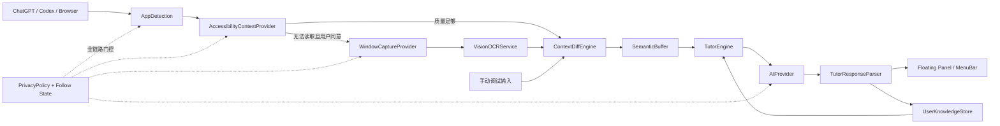

# 白话 AI V0.1 技术架构

> 文档状态：STEP 0 架构基线  
> 更新日期：2026-08-14  
> 目标平台：macOS 14+，优先 Apple Silicon  
> 技术栈：Swift、SwiftUI、必要处使用 AppKit  
> 本文只定义架构，不代表 STEP 1 已经开始编码。

## 1. 产品边界与架构目标

白话 AI 不是另一个聊天客户端。它是一个只读的教学伴侣：在用户使用 ChatGPT、Codex 等 AI 工具时，读取已经显示给用户的新增内容，把它翻译成零基础用户能理解的解释。

V0.1 架构优先保证以下事情：

1. 只在用户明确开启跟随时读取内容。
2. 优先读取结构化文字，不默认持续截屏。
3. 只处理新增内容，不反复解释整段对话。
4. 教学逻辑、上下文读取、AI 网络调用和界面互相解耦。
5. API Key 只进入 macOS Keychain。
6. 暂停后立即停止内容读取、OCR、网络请求和流式输出。
7. 不获取、不暗示获取模型隐藏思维链；只解释屏幕可见事实、合理依据和必要原理。

## 2. 关键架构决定

| 主题 | V0.1 决定 | 原因 |
|---|---|---|
| 工程形态 | 一个原生 macOS App target，加一个测试 target | 原型期先降低构建与依赖复杂度；目录和协议仍保持模块边界 |
| App 生命周期 | SwiftUI `App` 作为入口，AppKit 控制 `NSPanel` | `MenuBarExtra` 和设置适合 SwiftUI；悬浮窗行为需要 AppKit |
| 主界面 | `MenuBarExtra` + SwiftUI 内容的 `NSPanel` | 符合轻量、随用随开的产品定位 |
| App 类型 | `LSUIElement` 菜单栏应用，不显示常驻 Dock 图标 | 避免传统大型主窗口成为第一体验 |
| 快捷键 | 默认 Option + Space，可在设置中修改 | 与需求一致；实现时优先选择不额外触发隐私权限的系统热键方案 |
| 状态管理 | `@MainActor @Observable` 的 App/UI 状态；I/O 服务使用 actor 或 `Sendable` 类型 | 避免 Massive View 和跨线程 UI 更新 |
| 依赖注入 | `AppContainer` 在启动时组装协议实现 | 避免把业务服务写成大量 Singleton，方便测试替换 |
| 上下文来源 | Accessibility → 单窗口截图 → Vision OCR；保留 manual 调试来源 | 结构化文字更准确、耗能更低，OCR 只做兜底 |
| 触发方式 | AX/Workspace 事件为主，0.8～1.5 秒受限轮询补漏 | AX 通知在不同 App 中并不完全可靠，但不能无脑高频轮询 |
| OCR | 只截取用户确认的目标窗口单帧，内存中处理后丢弃 | 最小化屏幕读取范围，不持续录制桌面 |
| AI 接口 | 自有 `AIProvider`；首个实现为 OpenAI-compatible Chat Completions | 保持与不同服务兼容，同时不让 Tutor Engine 依赖某家 SDK |
| 流式传输 | `AsyncThrowingStream` + SSE 增量解析 + 最终结构校验 | 支持取消、错误传播和实时 UI |
| 结构化输出 | 能力协商后使用 JSON Schema；不支持时退化为严格 JSON Prompt | “OpenAI-compatible”服务对结构化输出的支持并不一致 |
| 知识记录 | Application Support 中的轻量 JSON，由 actor 原子写入 | V0.1 数据简单、透明，不需要引入数据库；以后可替换实现 |
| 普通设置 | `UserDefaults` | 只保存非敏感偏好，例如教学程度、窗口位置、跟随开关 |
| 密钥 | macOS Keychain | 不进入源码、plist、UserDefaults 或日志 |
| 原始内容留存 | 默认不持久化屏幕截图、OCR 图片、完整上下文或 AI 对话 | 产品不需要长期保存这些高敏感数据 |
| Sandbox | V0.1 本地开发阶段先不启用 App Sandbox；保持最小权限 | Accessibility 客户端能力和 TCC 行为必须先通过 STEP 2 实测；上架不在 V0.1 范围 |

Swift Package 是否进一步拆分，等 STEP 3 的纯逻辑测试稳定后再决定。现在先依靠目录、协议和访问控制保持边界，避免为了“看起来模块化”而增加原型成本。

## 3. 总体分层



### 分层职责

- **App / Composition Root**：创建服务、连接依赖、处理生命周期。
- **UI**：展示状态和教学结果，只通过 ViewModel 发出用户意图。
- **Context**：检测目标 App、读取可见文字、评估质量、提取新增内容。
- **Tutor**：分类领域、构建教学 Prompt、解释结果、风险分级。
- **AI**：网络协议、流式事件、厂商兼容、错误模型。
- **Knowledge**：只保存知识点熟悉度，不保存完整屏幕历史。
- **Security / Privacy**：权限、Keychain、数据发送披露、日志脱敏。

## 4. 最终目录规划

STEP 1 创建工程时使用下面的目标结构。V0.1 中这些目录仍属于同一个 App target。

```text
AITutorMac/
├── AITutorMac.xcodeproj/
├── AITutorMac/
│   ├── App/
│   │   ├── AITutorApp.swift
│   │   ├── AppDelegate.swift
│   │   ├── AppContainer.swift
│   │   ├── AppState.swift
│   │   └── FollowCoordinator.swift
│   ├── UI/
│   │   ├── FloatingPanel/
│   │   │   ├── FloatingPanelController.swift
│   │   │   ├── FloatingPanelView.swift
│   │   │   └── TutorResultView.swift
│   │   ├── MenuBar/
│   │   │   └── MenuBarContentView.swift
│   │   ├── Permission/
│   │   │   ├── WelcomeView.swift
│   │   │   └── PermissionViewModel.swift
│   │   ├── Settings/
│   │   │   ├── SettingsView.swift
│   │   │   └── ProviderSettingsView.swift
│   │   ├── Debug/
│   │   │   └── ContextDebugView.swift
│   │   └── Shared/
│   ├── Context/
│   │   ├── Core/
│   │   │   ├── ContextProvider.swift
│   │   │   ├── AppContext.swift
│   │   │   ├── ContextEvent.swift
│   │   │   └── ContextQualityEvaluator.swift
│   │   ├── AppDetection/
│   │   │   └── FrontmostAppMonitor.swift
│   │   ├── Accessibility/
│   │   │   ├── AccessibilityPermissionService.swift
│   │   │   ├── AccessibilityContextProvider.swift
│   │   │   ├── AXObserverCoordinator.swift
│   │   │   ├── AXTextExtractor.swift
│   │   │   └── AXTraversalBudget.swift
│   │   ├── ScreenCapture/
│   │   │   ├── ScreenCapturePermissionService.swift
│   │   │   └── WindowCaptureProvider.swift
│   │   ├── OCR/
│   │   │   └── VisionOCRService.swift
│   │   ├── Diff/
│   │   │   ├── ContextDiffEngine.swift
│   │   │   ├── ContextIdentity.swift
│   │   │   └── TextNormalizer.swift
│   │   ├── Buffer/
│   │   │   └── SemanticBuffer.swift
│   │   └── Strategies/
│   │       ├── GenericAXStrategy.swift
│   │       ├── ChatGPTAXStrategy.swift
│   │       └── CodexAXStrategy.swift
│   ├── Tutor/
│   │   ├── TutorEngine/
│   │   │   ├── TutorEngine.swift
│   │   │   └── DefaultTutorEngine.swift
│   │   ├── PromptBuilder/
│   │   │   └── TutorPromptBuilder.swift
│   │   ├── ResponseParser/
│   │   │   ├── TutorResponseParser.swift
│   │   │   └── IncrementalTutorDecoder.swift
│   │   ├── DomainClassifier/
│   │   │   └── HeuristicDomainClassifier.swift
│   │   └── Risk/
│   │       └── LocalRiskEvaluator.swift
│   ├── AI/
│   │   ├── Providers/
│   │   │   ├── AIProvider.swift
│   │   │   ├── AIProviderCapabilities.swift
│   │   │   └── OpenAICompatibleProvider.swift
│   │   ├── Streaming/
│   │   │   ├── SSEParser.swift
│   │   │   └── AIStreamEvent.swift
│   │   └── Models/
│   │       ├── AIRequest.swift
│   │       └── AIProviderError.swift
│   ├── Knowledge/
│   │   └── UserKnowledgeStore/
│   │       ├── UserKnowledgeStore.swift
│   │       ├── JSONUserKnowledgeStore.swift
│   │       └── KnowledgeRecord.swift
│   ├── Security/
│   │   ├── Keychain/
│   │   │   ├── CredentialStore.swift
│   │   │   └── KeychainCredentialStore.swift
│   │   └── Privacy/
│   │       ├── PrivacyPolicy.swift
│   │       └── DataDisclosure.swift
│   ├── Models/
│   │   ├── TutorExplanation.swift
│   │   ├── TutorRequest.swift
│   │   └── TeachingLevel.swift
│   ├── Utilities/
│   │   ├── AppLogger.swift
│   │   ├── Debouncer.swift
│   │   └── Clock.swift
│   ├── Resources/
│   ├── Info.plist
│   └── AITutorMac.entitlements
├── AITutorMacTests/
│   ├── ContextDiffEngineTests.swift
│   ├── SemanticBufferTests.swift
│   ├── TutorResponseParserTests.swift
│   ├── LocalRiskEvaluatorTests.swift
│   └── UserKnowledgeStoreTests.swift
└── docs/
    ├── ARCHITECTURE.md
    ├── MVP_SCOPE.md
    ├── REFERENCE_RESEARCH.md
    └── ACCESSIBILITY_TEST.md      # STEP 2 创建
```

`ChatGPTAXStrategy` 和 `CodexAXStrategy` 只允许包含“如何从该 App 的可访问树中选择内容”的规则，不允许把网络调用或教学逻辑放进去。

## 5. 核心数据模型与协议

### 5.1 AppContext

```swift
enum ContextSource: String, Codable, Sendable {
    case accessibility
    case ocr
    case manual
}

struct AppContext: Equatable, Sendable {
    let appName: String
    let bundleIdentifier: String?
    let windowTitle: String?
    let text: String
    let timestamp: Date
    let source: ContextSource
    let confidence: Double
}
```

`confidence` 代表“这段内容像不像目标 AI 的可见回答”，不是 AI 回答本身是否正确。

```swift
protocol ContextProvider: Sendable {
    func currentContext() async throws -> AppContext
}
```

### 5.2 Tutor 输出

```swift
struct TutorExplanation: Codable, Equatable, Sendable {
    let activity: String
    let plainExplanation: String
    let why: String
    let principle: String
    let terms: [TutorTerm]
    let riskLevel: RiskLevel
    let riskExplanation: String
    let nextAction: String
    let learningPoint: String
    let confidence: Double
}

enum RiskLevel: String, Codable, Sendable {
    case none, low, medium, high
}
```

`terms` 最多 3 项。所有字段最终都必须经过本地校验；缺字段、非法风险级别或无法解码时，不把半成品当成可靠结论展示。

### 5.3 AI Provider

```swift
protocol AIProvider: Sendable {
    var capabilities: AIProviderCapabilities { get }

    func stream(
        request: AIRequest
    ) -> AsyncThrowingStream<AIStreamEvent, Error>
}
```

Tutor Engine 只认识这个协议，不认识 URLSession、SSE、OpenAI、Anthropic 或任何具体模型名。

## 6. App 启动与状态管理

`AppContainer` 是唯一的组装点，负责创建：

- `FrontmostAppMonitor`
- Context Provider 和 `ContextDiffEngine`
- `SemanticBuffer`
- `TutorEngine`
- `AIProvider`
- `CredentialStore`
- `UserKnowledgeStore`
- `FloatingPanelController`

状态分为：

```text
idle
waitingForAccessibilityPermission
following
processing
paused
waitingForScreenCapturePermission
error
```

状态变化必须有明确副作用：

- 进入 `following`：只为当前受支持目标建立观察。
- 进入 `paused`：移除 AX observer、停止 fallback polling、取消 OCR、取消网络 Task、清空尚未发送的语义缓冲。
- 目标 App 切换：先解除旧 PID/窗口观察，再创建新观察；不同窗口的 diff 历史不能串用。
- App 退出或 PID 改变：释放 observer token 和 RunLoop source，避免悬挂引用。

## 7. Context Acquisition

### 7.1 前台 App 检测

`FrontmostAppMonitor` 使用：

- `NSWorkspace.shared.frontmostApplication` 获取初始状态。
- `NSWorkspace.shared.notificationCenter` 监听 `didActivateApplicationNotification`。
- 记录 app name、bundle identifier、PID。

只把 ChatGPT、Codex 和用户明确允许的浏览器窗口交给内容读取层。未知 App 默认不读取文字。

### 7.2 Accessibility 优先路径

权限由用户在 Welcome 中点击后请求。没有权限时只显示说明和进入系统设置的按钮，不反复弹系统提示。

读取路径：

1. 根据 PID 创建 application `AXUIElement`。
2. 读取 focused window 和窗口标题。
3. 优先检查 focused element、text area、static text、web area、scroll area。
4. 从 `AXValue`、`AXTitle`、`AXDescription`、`AXSelectedText` 等可见属性提取文本。
5. 通过 App strategy 过滤菜单、侧栏、按钮标签等非回答内容。
6. 交给质量评估器，达到阈值才进入 diff。

为了防止深层 Web/Electron 可访问树拖垮主线程，遍历必须同时受以下预算限制：

- 最大深度
- 最大节点数
- 最大字符数
- 单次读取超时
- 只从当前窗口或已定位的会话容器开始

建议初始预算为 8 层、2,000 节点、30,000 字符、250ms；STEP 2 根据 ChatGPT、Codex、Safari、Chrome 实测调整，不能把这些数当作永久真理。

### 7.3 事件驱动与补漏轮询

优先订阅与当前 PID/窗口有关的通知：

- value changed
- selected text changed
- focused UI element changed
- focused window changed
- window created / destroyed
- title changed（目标 App 支持时）

事件统一进入 debounce/coalescing 层，短时间内多次通知只触发一次读取。建议初始 debounce 为 250ms。

AX 通知在 Electron、Web Area 或高频流式文本中可能漏报，因此允许受限 polling：

- 只在 `following` 且当前 App 受支持时运行。
- 建议 1.0 秒起步，允许在 0.8～1.5 秒内按实测调整。
- 连续无变化时指数退避到 3～5 秒。
- 新 AX 事件到来后恢复基础间隔。
- 暂停、App 切换、锁屏或睡眠时立即停止。

### 7.4 ContextQualityEvaluator

以下情况视为低质量：

- 空文本或只有控件标签。
- 相同按钮/菜单词重复占比过高。
- 文本明显被截断且没有稳定尾部。
- 当前 App 与捕获 PID/窗口不一致。
- OCR 置信度或有效字符比例过低。

连续若干次低质量后只提示“当前应用无法直接读取文字”，不会自动申请 Screen Recording 权限。

## 8. Context Diff

这是核心纯逻辑模块，必须有高覆盖率单元测试。

每个 `ContextIdentity` 独立保存上次上下文：

```text
bundle identifier + PID + focused window identity + source
```

不能只使用 `current.dropFirst(previous.count)`。真实场景还包含流式补字、Markdown 重排、窗口滚动、旧消息重新出现和 OCR 抖动。

建议流水线：

1. **规范化**：统一换行、Unicode、零宽字符和无意义空白，但保留段落边界与标点。
2. **完全相同**：直接返回 `noChange`。
3. **追加快路径**：当前内容以前文开头时只取尾部。
4. **尾部增量路径**：按行或 token 求最长公共片段，提取稳定插入段。
5. **OCR 模糊去重**：对相邻行使用保守相似度，只消除小范围识别抖动。
6. **替换/重置识别**：窗口切换、会话切换或大段重写时标记为 `reset`/`ambiguous`，不把整屏自动当作新回答。
7. **历史去重**：近期已解释片段以指纹保留短时间窗口，避免滚动后重复解释。

输出建议使用：

```swift
enum ContextChange: Equatable, Sendable {
    case noChange
    case appended(String)
    case inserted(String)
    case reset
    case ambiguous
}
```

必须覆盖的测试：

- 完全重复
- 单句追加
- 单个 token 持续增长
- Markdown 换行重排
- 用户滚动到旧回答
- App/窗口切换
- OCR 中一两个字变化
- AI 修改上一句而不是继续追加
- 超长内容截断
- 中英文混合和代码块

## 9. Semantic Buffer

Context Diff 的每一个微小增量不能立即调用 Tutor。`SemanticBuffer` 按窗口维护缓冲，满足任一条件才输出教学片段：

- 遇到完整句号、问号、感叹号或稳定换行。
- 文本停止变化约 700ms。
- 达到最大长度，例如 800 字符。
- 命中短而完整的工具状态，例如 `Build succeeded`、`Migration failed`。

补充规则：

- 太短且明显未完成的片段继续等待。
- 最长等待不超过约 1.2 秒，避免“实时解释”变成明显延迟。
- AI Provider 正在处理时，新片段进入队列，不因每个新 token 取消当前解释。
- 快速连续片段可以合并，但不能跨 App、窗口或会话合并。

## 10. OCR fallback

OCR 只在以下条件全部满足时启用：

1. Accessibility 权限已处理但内容质量持续不足。
2. 用户看到了“为什么需要屏幕读取”的说明。
3. 用户主动点击开启 Screen Recording。
4. 已经确定要读取的目标窗口。

实现路径：

```text
SCShareableContent
    → 按 PID、标题、frame 匹配 SCWindow
    → SCContentFilter(desktopIndependentWindow:)
    → SCScreenshotManager 单帧截图
    → VNRecognizeTextRequest
    → ContextQualityEvaluator
    → ContextDiffEngine
```

关键约束：

- 不启动持续桌面录像。
- 不截取所有显示器。
- 图片只存在内存中，OCR 完成立即释放。
- 不把图片上传给教学模型；V0.1 云端只发送必要文字。
- 默认识别中文和英文，使用 Vision 支持的语言自动检测/语言纠正能力。
- 目标窗口发生变化时重新确认匹配，避免截错窗口。
- OCR polling 初始不快于约 1.2 秒；无变化时退避。
- 当前 Panel 不能成为捕获目标。

Apple 的 ScreenCaptureKit 支持用内容过滤器限定单个窗口；Vision 的文字识别可以在速度与准确度之间选择。V0.1 先使用准确模式，STEP 6 再用真实延迟决定是否对流式场景切换为两阶段识别。

## 11. Tutor Engine

### 11.1 输入

`TutorRequest` 包含：

- 当前 App 和窗口信息
- 用户原始问题（能可靠获取时才传）
- AI 新增回答
- 上一段必要上下文，不传整段历史
- 当前领域
- 用户教学程度
- 相关知识点熟悉度
- 解释模式：普通、再简单一点、生活例子、从头解释、讲深一点
- 来源和置信度

### 11.2 Prompt 原则

Prompt 必须明确：

- 用户默认零基础。
- 第一次解释控制在 3～5 句，术语最多 3 个。
- 用生活语言解释，不用更多术语解释术语。
- 只依据屏幕可见内容，不虚构执行结果。
- 低置信度时写明“目前只能根据屏幕内容推测”。
- `Build succeeded` 只代表构建通过，不代表没有 Bug。
- 删除、数据库、权限、密钥、部署和 Git 覆盖操作提高风险关注。
- 输出的是可理解的依据和原理，不是模型隐藏思维链。

### 11.3 DomainClassifier

V0.1 使用本地轻量启发式分类，避免为了分类再增加一次云端请求：

```text
programming, film, design, business, finance, academic, general, unknown
```

分类置信度低时使用 `general` 教学风格；不能为了凑分类而虚构专业背景。

### 11.4 风险双层判断

风险不能完全交给生成模型。

1. `LocalRiskEvaluator` 根据可见关键词和操作类型给出最低风险级别。
2. Tutor Provider 给出语义风险判断。
3. 最终等级取两者较高值，并把依据写成用户可核对的短句。

本地规则只做保守提示，不宣称操作已执行。例如看到 `rm`、`DROP TABLE`、migration、权限策略、API key 或 deploy 时提高关注；只有屏幕明确显示成功/失败时才描述结果。

## 12. 结构化输出与 Streaming

“边生成边显示”和“最终 JSON 必须合法”天然存在张力。V0.1 不假装每一家兼容服务都能稳定输出可增量解析的 JSON。

处理策略：

1. Provider 先声明 `supportsStreaming` 和 `supportsJSONSchema`。
2. 支持 JSON Schema 时，请求固定的 `TutorExplanation` schema。
3. 不支持时，用严格 JSON Prompt，并在本地最终解码。
4. SSE 层只负责把网络 chunk 转成文本 delta，不理解 Tutor 字段。
5. `IncrementalTutorDecoder` 只展示已经形成稳定边界的字段；未闭合 JSON 不当作最终结果。
6. 流结束后使用 `JSONDecoder` 和业务规则做最终校验。
7. 解码失败时展示明确错误和“重试”按钮，不把猜测修复成事实。

UI 体验可以是：先出现“AI 正在做什么”，字段完成后再出现“大白话”“为什么”等区块；不要求每个字段的每个 token 都立即可见。

OpenAI-compatible 首个适配器使用通用的 Chat Completions SSE 形态：读取 `data:` 事件、解析 `choices[].delta.content`、识别 `[DONE]`、支持 Task 取消。OpenAI 官方文档显示流式 chunk 是 `chat.completion.chunk`，内容位于 delta 中；但第三方服务可能只有部分兼容，因此必须通过连接测试和 capability 设置降级，不能硬编码假设。

## 13. AI Provider 与网络安全

`OpenAICompatibleProvider` 的设置包括：

- Base URL
- Model name
- API Key 的 Keychain 引用
- 是否支持 streaming
- 是否支持 JSON Schema
- 连接测试状态

网络层规则：

- 使用 ephemeral `URLSessionConfiguration`，不依赖 cookie/cache。
- 云端 Base URL 必须使用 HTTPS；仅 loopback 地址允许 HTTP，为未来本地服务保留空间。
- API Key 只在请求构造瞬间从 Keychain 读取。
- 不记录 Authorization header、请求正文或完整响应。
- 跨主机重定向默认拒绝，防止密钥被带到未知地址。
- 设置合理的连接、首 token、总请求超时。
- 401、403、429、超时、断流、非法 SSE、结构解析失败使用不同用户提示。
- 暂停跟随、关闭 Panel 或切换 Provider 时取消相关 Task。

V0.1 不实现 Anthropic、Gemini、Ollama、LM Studio 专用适配器；协议和 loopback 安全规则为后续保留扩展位。

## 14. User Knowledge Model

```swift
struct KnowledgeRecord: Codable, Sendable {
    let concept: String
    var level: Double
    var explanationCount: Int
    var confusionCount: Int
    var lastExplainedAt: Date
}
```

V0.1 规则：

- 第一次出现：`0.2`
- 点击“我还是没懂”：`-0.1`
- 多次遇到且没有再次请求解释：`+0.05`
- 始终限制在 `0...1`

更新必须由明确用户行为或完成的解释触发，不能仅因为内容从屏幕经过就断言用户学会了。

持久化位置为 App 的 Application Support 目录，采用原子写入。只保存知识点名、熟悉度和统计，不保存原始回答、截图或 Prompt 全文。存储通过 `UserKnowledgeStore` 协议抽象，未来可以替换为 SwiftData/SQLite。

## 15. UI 架构

### 15.1 MenuBarExtra

菜单项：

```text
白话 AI ●
正在跟随：Codex
打开教学窗口
暂停/继续跟随
设置
退出
```

状态点必须区分：跟随中、处理中、已暂停、缺少权限、发生错误。

### 15.2 Floating NSPanel

`FloatingPanelController` 创建可成为 key window、不能成为 main window 的 `NSPanel`，使用 `NSHostingController` 承载 SwiftUI。

行为：

- 原生材质/毛玻璃，信息层级清楚，保证文字对比度。
- 可拖动、可固定、可隐藏。
- 可加入所有 Spaces，并能作为 full-screen auxiliary。
- Esc 隐藏；Option + Space 切换显示。
- 隐藏 Panel 不等同于暂停跟随；界面必须清楚显示两者区别。
- “暂停全部读取”是独立、随时可见的安全操作。
- “我还是没懂”展开四种重解释方式，不把所有按钮一直堆在首屏。

### 15.3 Permission UI

权限分阶段请求：

1. Welcome 解释产品做什么。
2. 用户点击后请求 Accessibility。
3. 只有 Accessibility 实测不足时，解释并请求 Screen Recording。

设置页持续显示：

```text
当前正在读取：Codex / 无
读取方式：Accessibility / OCR / Manual
屏幕录制：未启用 / 已授权 / 使用中
云端发送：关闭 / 将发送文字到指定 Provider
```

### 15.4 Debug UI

STEP 2 增加开发者 Debug 面板：

- 当前 App
- Bundle Identifier
- 当前窗口
- Accessibility 原始文字
- 质量分数与失败原因
- FULL CONTEXT
- NEW CONTEXT

Debug 内容默认只在内存中展示，不写日志、不持久化；Release 构建不暴露原始上下文调试入口。

## 16. Privacy 与权限边界

`PrivacyPolicy` 是所有采集入口之前的门，不是 UI 上的一段说明文字。

### 默认规则

- 跟随默认关闭，或首次完成说明后由用户明确开启。
- 只读取受支持且用户允许的目标 App/窗口。
- 不读取密码字段、Secure Text Field 或白话 AI 自身窗口。
- 不自动点击、输入、粘贴或控制其他 App。
- 不持续录制屏幕。
- 不持久化原始屏幕内容。
- 不把截图上传到 AI Provider。
- 发送云端前展示 Provider 名称和“会发送新增文字”的说明。

### 暂停语义

“暂停全部读取”必须做到：

- 注销 AX notifications。
- 停止 fallback polling。
- 停止截图/OCR。
- 取消或关闭未完成网络请求。
- 不继续积累 Semantic Buffer。

### 日志

使用 `os.Logger` 分类记录生命周期、耗时和错误码。用户内容、窗口标题、API Key、请求正文标记为 private 或完全不记录。诊断导出只包含版本、权限状态、Provider 类型和错误码。

## 17. 错误与可观察性

统一错误域：

- PermissionError
- AppDetectionError
- AccessibilityError
- ScreenCaptureError
- OCRError
- ContextDiffError
- ProviderError
- TutorParseError
- KeychainError
- KnowledgeStoreError

面向用户的错误必须说明下一步，例如“请在系统设置开启辅助功能，然后返回白话 AI 重试”，而不是只显示 AXError 或 HTTP 429。

建议记录无内容的性能指标：

- AX 读取耗时
- 遍历节点数
- diff 输入/输出字符数
- Semantic Buffer 等待时长
- Provider 首 token / 总耗时
- OCR 耗时和是否因无变化跳过

## 18. 测试策略

### 单元测试

- Context Diff 的所有边界情况
- Semantic Buffer 的标点、空闲超时、取消、跨窗口隔离
- PromptBuilder 不泄漏不必要历史
- Tutor JSON 最终校验和非法风险等级
- 本地风险下限
- User Knowledge 更新与 `0...1` 边界
- Keychain 使用 mock store，不在单测写真实 Keychain

### 集成测试

- 使用 fixture SSE 测试分块、半行、多个 data event、`[DONE]`、断流和取消
- 使用保存的“人工脱敏 AX 树 fixture”测试文本选择策略
- 使用本地测试图片测试中英文 OCR 和阅读顺序

### 手工测试

STEP 2 必须在真实 ChatGPT、Codex、Safari、Chrome 中填写 `docs/ACCESSIBILITY_TEST.md`。架构研究不能替代 TCC 和可访问树实测。

## 19. 主要技术风险

| 风险 | 影响 | V0.1 缓解措施 |
|---|---|---|
| ChatGPT/Codex 的 AX 树结构随版本变化 | 读取不到或选错内容 | 通用提取器 + 小型 App strategy；STEP 2 记录真实层级，不硬编码单一路径 |
| Electron/Web Area 不发稳定通知 | 自动跟随漏内容 | AXObserver 为主，受限 polling 补漏，切换 App 时重建观察 |
| 深层 AX 遍历卡顿 | 主线程卡顿、CPU 高 | 深度/节点/字符/时间预算，缩小到 focused window，耗时监控 |
| 读取范围过大 | 把侧栏、旧对话或隐私内容发给云端 | 目标窗口和回答区域过滤、发送最小增量、设置中持续披露 |
| Diff 把重排当新增 | 重复解释、浪费费用 | 多阶段 diff、窗口隔离、近期指纹、模糊场景不自动发送 |
| OCR 抖动与阅读顺序错误 | 重复或语义混乱 | 质量门、模糊去重、稳定等待、真实中英文 fixture |
| 目标窗口与 `SCWindow` 匹配错误 | 截取错误 App | PID + 标题 + frame 联合匹配；不唯一时让用户选择 |
| Screen Recording 首次授权/签名变化 | 授权后仍无法捕获 | 权限状态机、明确重启提示、保持开发签名稳定 |
| Streaming JSON 中途不合法 | UI 无法逐字解析 | 增量只展示稳定字段，流结束后严格解码，能力不支持时降级 |
| 各家“OpenAI-compatible”差异 | 请求参数或 SSE 格式失败 | Provider capability、连接测试、兼容降级、错误分类 |
| 模型虚构“AI 正在做什么” | 误导零基础用户 | 只给可见增量、置信度措辞、最终 schema 校验、本地风险下限 |
| API Key 通过日志/跳转泄漏 | 严重安全问题 | Keychain、ephemeral session、禁止跨主机重定向、正文不进日志 |
| 高频调用成本和延迟 | 使用体验差、费用失控 | Context Diff、Semantic Buffer、队列合并、请求取消和速率限制 |
| App Sandbox/TCC 能力组合不确定 | 后期签名和分发返工 | V0.1 非沙盒实验；STEP 2 记录签名、权限和重启行为，发布前重新评估 |
| 开源许可证污染商业代码 | 无法闭源发布 | 见 `REFERENCE_RESEARCH.md`；GPL、Screenpipe 当前代码、TextOCR 代码不复制 |

## 20. V0.1 开发顺序与质量闸门

1. **STEP 0：架构文档**  
   完成本文件、MVP 范围和参考项目/许可证研究。用户确认后才编码。
2. **STEP 1：最小 App 壳**  
   MenuBarExtra、Floating NSPanel、Option + Space、Esc。完全不接 AI、不读其他 App。
3. **STEP 2：Accessibility 实验**  
   权限引导、App/窗口检测、受限 AX 文本读取、Debug 面板；在四个目标 App 中完成报告。
4. **STEP 3：Context Diff**  
   纯逻辑引擎、FULL/NEW 调试 UI、重复与流式场景单元测试。
5. **STEP 4：Tutor Engine（手动触发）**  
   Keychain、Provider 设置、OpenAI-compatible SSE、结构解析、手动“解释当前新增内容”和“我还是没懂”。
6. **STEP 5：自动跟随**  
   AX 事件、debounce、Semantic Buffer、受限 polling、暂停时全链路停止。
7. **STEP 6：OCR fallback**  
   渐进式 Screen Recording 权限、指定窗口单帧、Vision OCR、diff、性能与隐私验证。

每一步只有在以下条件满足后进入下一步：功能可以由零基础用户按文档复现、错误和隐私状态可见、相关测试通过、已知问题如实记录。

## 21. 官方技术依据

- Apple [NSWorkspace](https://developer.apple.com/documentation/appkit/nsworkspace) 提供前台 App 生命周期通知。
- Apple [AXIsProcessTrustedWithOptions](https://developer.apple.com/documentation/applicationservices/1459186-axisprocesstrustedwithoptions) 用于检查/请求 Accessibility 信任状态。
- Apple [ScreenCaptureKit 单窗口捕获示例](https://developer.apple.com/documentation/screencapturekit/capturing-screen-content-in-macos) 展示通过 `SCContentFilter` 限定窗口。
- Apple [SCScreenshotManager](https://developer.apple.com/documentation/screencapturekit/scscreenshotmanager) 支持从内容过滤器获取单帧截图。
- Apple [VNRecognizeTextRequest](https://developer.apple.com/documentation/vision/vnrecognizetextrequest) 用于本机文字识别。
- OpenAI 官方 [Chat API Reference](https://developers.openai.com/api/reference/resources/chat) 描述 Chat Completions 的流式 delta 和结构化响应参数。V0.1 只把它作为首个兼容适配器的协议依据，不把 Tutor Engine 绑定到 OpenAI。

